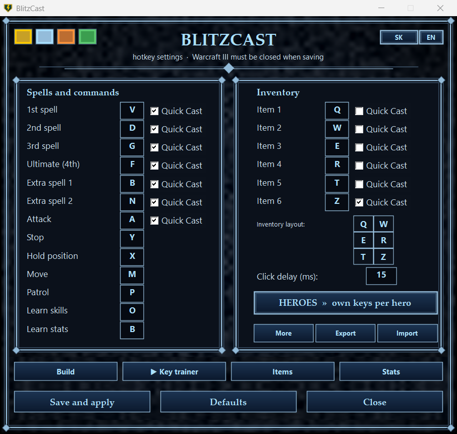
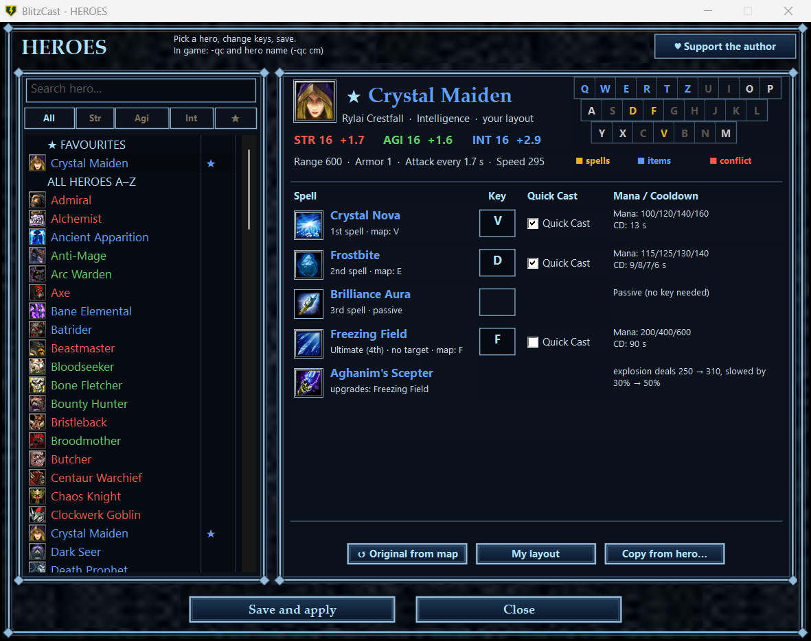
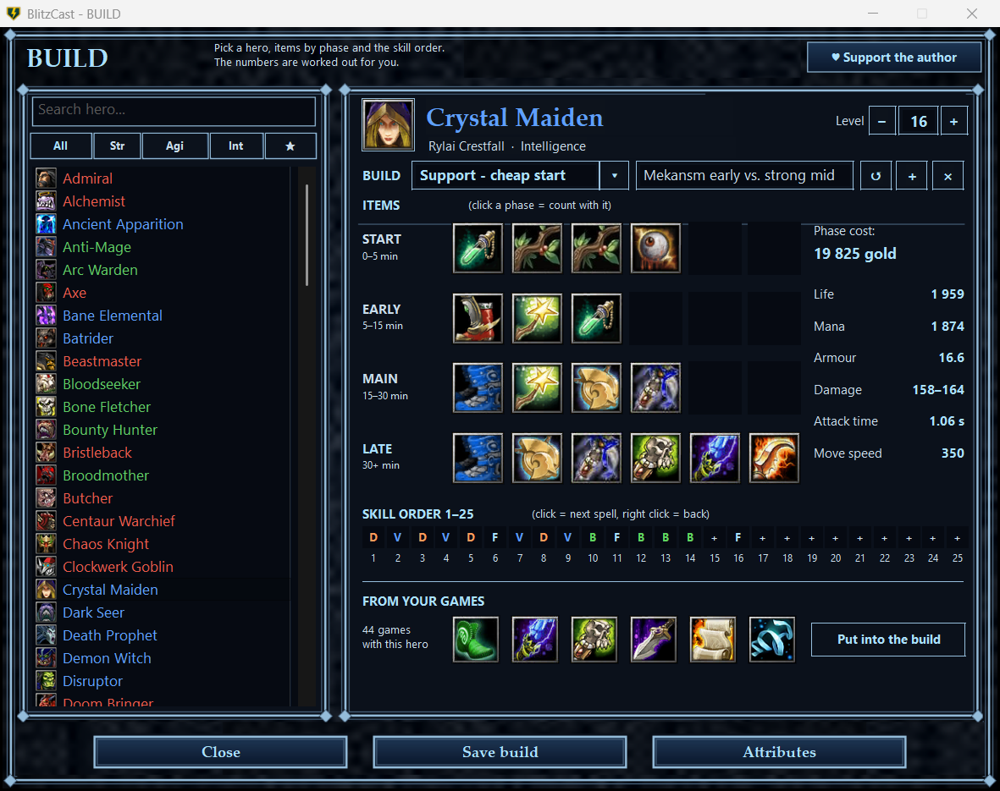
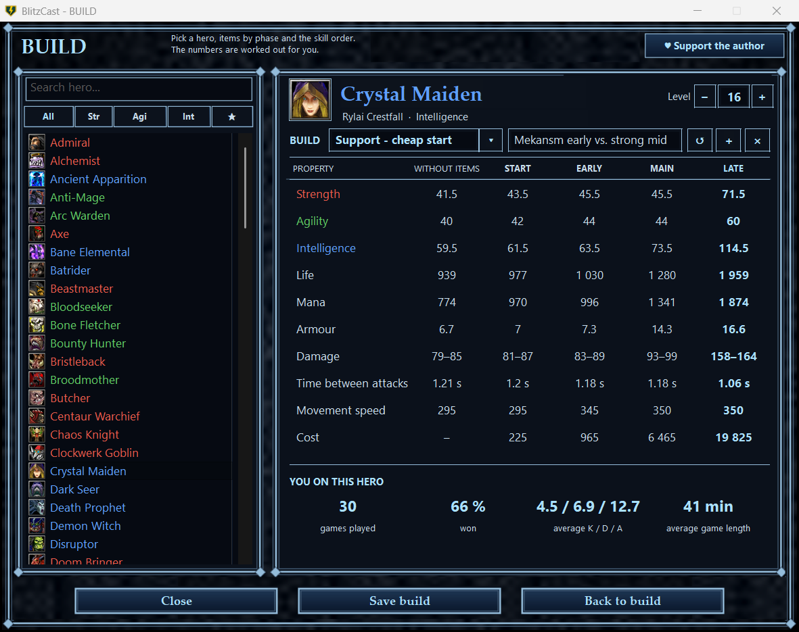
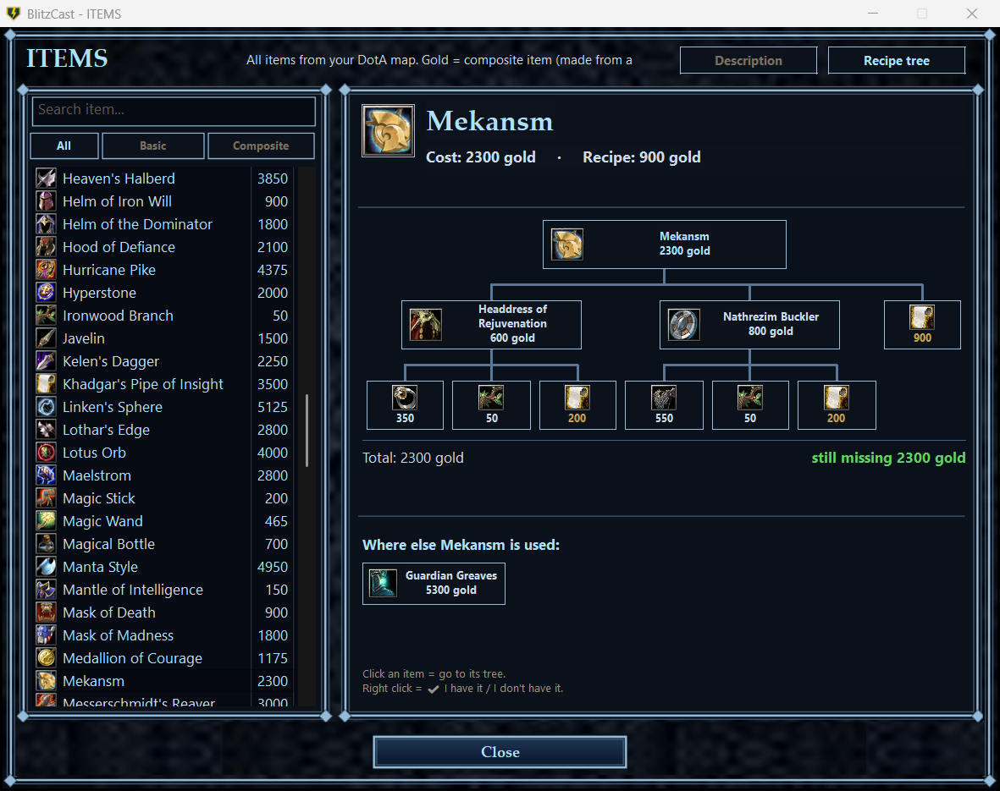
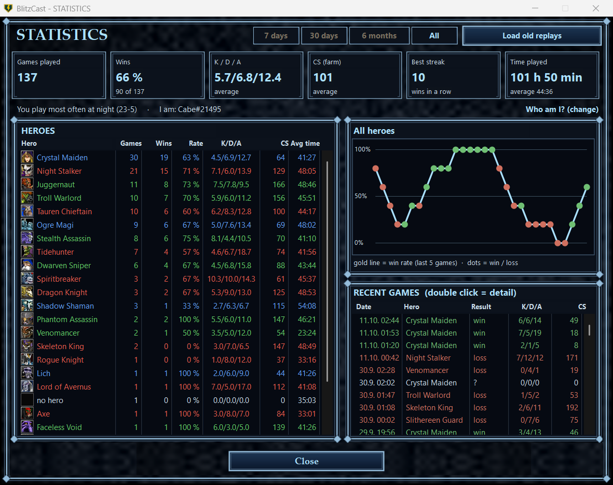
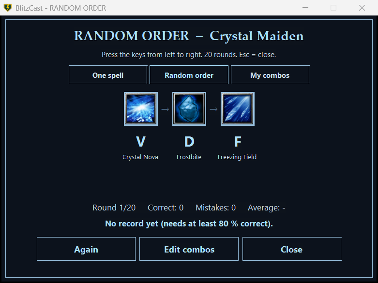
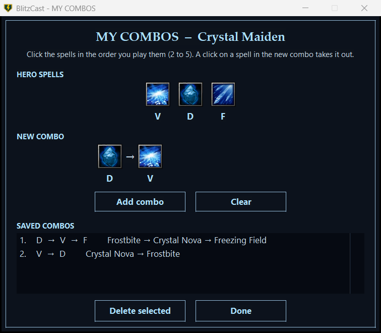

# BlitzCast ⚡

**BlitzCast** is a free helper for **DotA in Warcraft III: Reforged** – better hotkeys, Quick Cast,
hero builds, timers, a key trainer and statistics from your own replays.

I made it because I wanted better hotkeys and Quick Cast for my own games. Now I'm looking for
feedback from other players – what works, what is missing, what is annoying.

Made by **AD Studio** (independent developer from Slovakia).

---

## Features

### ⚡ Hotkeys and Quick Cast
- Your own keys for spells, items and commands, written straight into the game.
- **Quick Cast** per spell and per item slot, **self cast** (Alt + key).
- **Own keys for every hero** – the Heroes window shows all heroes of your DotA map with
  their spell icons, a mini keyboard with conflicts, Aghanim upgrades and Invoker's spells.

### 🛡️ Hero builds
- More builds per hero, **items by phase** (start / early / main / late) and the **skill order 1–25**.
- The numbers are worked out for you: life, mana, armour, damage, attack time, move speed and cost
  – for every phase side by side.
- **From your games:** the items you most often finish on that hero, read from your replays.

### 📦 Items
All items of your DotA map with descriptions and **recipe trees** (click a part to go to it).

### 📊 Statistics from your replays
Games, win rate, K/D/A, CS, best streak and time played – per hero and per game, read from
the replays on your computer. The program finds out which player you are by itself.

### 🎯 Key trainer
- **One spell**, **random order** (Invoker: real invoking – orbs + Invoke) and **my combos**.
- Make your own combos by clicking the spells in the order you play them. 20 rounds, records per hero.

### ⏱️ In-game timers
- **Runes and creeps** – time since the last rune (a rune at 2:00, creeps at 1:00), alert before the rune
  and for stacking. When a rune appears press the key again and the timer syncs to it
  (the game clock stops when the game lags, so a plain timer would drift).
- **Roshan** – time since his death, back between 8:00 and 11:00.
- Quick chat messages (Alt + 1…5) and start commands (Alt + 0).

### 🎨 Other
4 themes (stone, ice, blood, Forsaken) · English and Slovak · side mouse buttons as keys.

---

## Is it safe?
- BlitzCast **does not read or change game memory** and **does not play for you** – it only sends
  key and mouse presses, like a keyboard with extra keys.
- It contains **no Blizzard files or images** – icons are read from your own game.
- BlitzCast is an independent tool and is **not affiliated with, endorsed by or sponsored by
  Blizzard Entertainment**. Check the rules of your league / ladder before using any helper tool.

---

## Requirements
- Windows 10 or 11
- **Warcraft III: Reforged**
- the **DotA map** (it is downloaded when you play a DotA game in a lobby) – heroes, spells,
  items and icons are read from it. Without the map, hotkeys, Quick Cast, chat and timers still work.

## Installation
1. Download **`BlitzCast-v1.0.zip`** from [Releases](../../releases).
2. Unzip the whole folder anywhere (e.g. Documents).
3. Run **`BlitzCast.exe`** – Windows asks for administrator rights (needed to send keys to the game).
   If Windows shows *"Windows protected your PC"*, click **More info → Run anyway**
   (the program is not signed with a paid certificate).
4. Set your keys and click **Save and apply** – keys are written into the game while Warcraft III is closed.

Nothing is installed into Windows. To remove BlitzCast, just delete the folder.

---

## Support development ♥
BlitzCast is free. If you enjoy it and want to support future updates:

- **PayPal:** https://paypal.me/ADStudioSK
- **XRP:** address `rJn2zAPdFA193sixJwuFixRkYDUtx3apQh` + memo / destination tag **`500779782`**
  (**both are required** – without the memo the payment is lost)

## Feedback and contact
Bug reports, ideas and feedback are very welcome – open an [issue](../../issues) or write to
**adstudio.dev.sk@gmail.com**.

## License
Free for personal use. Selling, renting or modifying the program is not allowed.
See [LICENSE.txt](LICENSE.txt).

Good luck, have fun, and see you in Warcraft III! ⚡
